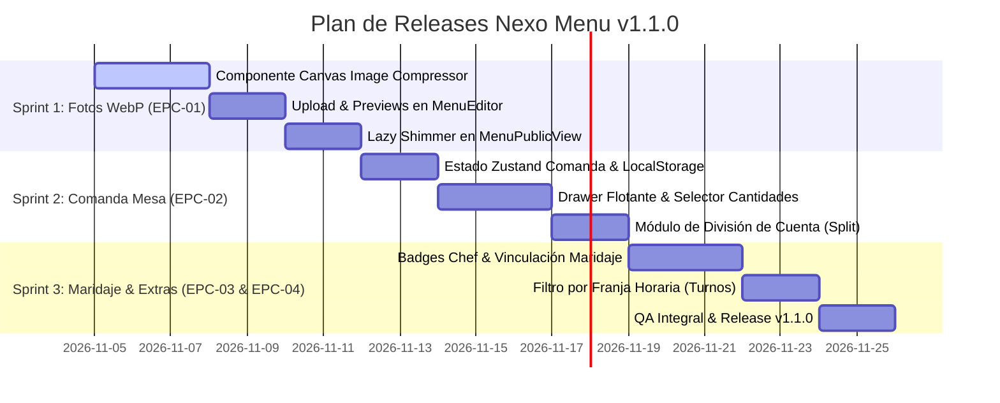

# ESPECIFICACIÓN DEL PRODUCT BACKLOG — NEXO MENU v1.1.0
**Documento Maestro de Backlog, Historias de Usuario (BDD) y Priorización Funcional**  
*Autor: Nexo-PO-Menu (Product Owner) | Producto: Nexo Menu (`nexo-menu`) | Versión: 1.1.0 | Fecha: Noviembre 2026*

---

## 1. Visión y Objetivos del Release v1.1.0

El objetivo del release **v1.1.0** es transformar a Nexo Menu desde un visualizador de carta digital hiper-rápido hacia una **herramienta interactiva de sala que incremente las ventas del restaurante (upselling) y reduzca la fricción en la mesa**.

### Métricas de Éxito de Producto (KPIs):
- **Aumento del Ticket Medio:** +8% a +15% estimado mediante fotografía atractiva y recomendaciones de maridaje.
- **Reducción del Tiempo de Atención en Mesa:** Ahorro de 2 a 3 minutos por mesa gracias a la comanda preliminar y el desglose de cuenta.
- **Rendimiento Móvil Invariable (Core Web Vitals):**
  - Largest Contentful Paint (LCP) en redes 4G móviles < 800 ms.
  - Peso máximo por imagen de plato optimizada < 100 KB.
  - First Input Delay / INP < 50 ms.
- **Cumplimiento Legal UE 1169/2011:** 100% de los platos con información explícita de alérgenos y advertencia de contaminación cruzada.

---

## 2. Mapa de Epics y Priorización MoSCoW

| Epic ID | Título de la Épica | Prioridad MoSCoW | Valor de Negocio | Complejidad Técnica |
| :--- | :--- | :---: | :---: | :---: |
| **EPC-01** | **Fotografía de Platos con Compresión WebP en Cliente** | **MUST HAVE** | Altísimo (conversión visual) | Media (Canvas / Web Workers) |
| **EPC-02** | **Comanda Preliminar en Mesa & División de Cuenta** | **MUST HAVE** | Altísimo (experiencia comensal) | Media (Zustand / LocalStorage) |
| **EPC-03** | **Recomendaciones del Chef y Maridaje Inteligente** | **SHOULD HAVE** | Alto (upselling de bebidas/postres)| Baja-Media (Metadata y Cross-links) |
| **EPC-04** | **Gestión de Turnos y Menús Dinámicos (Día/Noche/Finde)** | **COULD HAVE** | Medio-Alto (operatividad) | Media (Filtro por time-window) |

---

## 3. Desglose Detallado de Historias de Usuario (Formato BDD)

---

### 📷 EPIC 01: Fotografía de Platos con Compresión WebP en Cliente

#### US-101: Subida y Compresión de Imagen de Plato en el Editor
- **Como:** Hostelero o encargado de sala en el panel de edición de Nexo Menu.
- **Quiero:** Subir una fotografía de un plato desde mi móvil o PC y que se optimice automáticamente sin que yo tenga que editarla.
- **Para:** Mostrar una presentación profesional de mis platos sin ralentizar la carga para mis clientes ni agotar el almacenamiento.

```gherkin
Feature: Subida y compresión cliente de fotografías de platos
  Como hostelero
  Quiero añadir fotos a mis platos con compresión automática
  Para hacer mi carta más atractiva sin penalizar la velocidad de carga

  Scenario: Subida exitosa de una fotografía pesada tomada con smartphone
    Given que el hostelero está editando el plato "Hamburguesa Gourmet" en el MenuEditor
    When selecciona una fotografía JPEG de 8 MB y resolución 4032x3024 tomada con la cámara
    Then el cliente procesa la imagen en un Web Worker utilizando Canvas API
    And la resolución se escala a un máximo de 1200x800 píxeles manteniendo el aspect ratio
    And se convierte a formato WebP con calidad 0.82
    And el tamaño final del archivo resultante es inferior a 100 KB
    And se muestra una previsualización inmediata en el editor con un indicador de "Imagen Optimizada"

  Scenario: Rechazo de archivo con formato no soportado
    Given que el hostelero está en el modal de edición de plato
    When intenta subir un archivo con extensión .pdf o .exe
    Then el sistema bloquea la selección
    And muestra un mensaje toast de error amigable: "Por favor, selecciona una imagen válida (JPG, PNG o WEBP)"
```

---

#### US-102: Renderizado Responsive con Placeholder Blur en la Carta Pública
- **Como:** Comensal navegando la carta en `/m/[slug]`.
- **Quiero:** Ver las fotografías de los platos de forma fluida mientras hago scroll, sin saltos de maquetación (CLS).
- **Para:** Elegir con apetito lo que voy a comer sabiendo exactamente qué aspecto tiene el plato.

```gherkin
Feature: Visualización responsiva de fotografías de platos
  Como comensal en el restaurante
  Quiero ver fotos nítidas de los platos que carguen al instante
  Para decidir mi pedido con total seguridad visual

  Scenario: Carga progresiva con skeleton shimmer en red móvil 4G
    Given que el comensal accede a la carta pública "/m/bar-pepe" en un dispositivo móvil
    When hace scroll hacia la categoría "Especialidades de la Casa"
    Then los platos con imagen muestran un contenedor con proporción 16:9 y fondo skeleton animado
    And la imagen real en formato WebP se descarga de forma perezosa (loading="lazy")
    And una vez descargada, realiza una transición suave de fade-in sin alterar el alto del elemento (Cumulative Layout Shift = 0)
    And si el plato no tiene imagen asociada, la tarjeta del plato se ajusta limpiamente a diseño compacto de solo texto

  Scenario: Despliegue de imagen en alta resolución al pulsar
    Given que el comensal visualiza la miniatura de "Pulpo a la Brasa"
    When pulsa sobre la imagen del plato
    Then se abre un visor modal lightbox con la foto en alta resolución
    And se muestra el nombre, descripción completa y los badges de alérgenos asociados
    And puede cerrar el modal deslizando hacia abajo o pulsando fuera
```

---

### 📝 EPIC 02: Comanda Preliminar en Mesa & División de Cuenta

#### US-103: Selección de Platos y Carrito Flotante de Comanda
- **Como:** Comensal en la mesa del restaurante.
- **Quiero:** Ir añadiendo los platos y bebidas que nos gustan a una comanda preliminar interactiva.
- **Para:** Tener claro todo lo que vamos a pedir antes de que venga el camarero a tomar la orden.

```gherkin
Feature: Comanda preliminar interactiva en mesa
  Como comensal
  Quiero armar una comanda temporal en la carta
  Para agilizar el pedido cuando se acerque el camarero

  Scenario: Añadir platos a la comanda preliminar
    Given que el comensal está viendo el plato "Ración de Croquetas Caseras" con precio 10.50 €
    When pulsa en el botón "+" o "Añadir a comanda"
    Then el contador de unidades del plato se incrementa a 1
    And aparece una barra flotante en la parte inferior de la pantalla indicando: "1 producto · 10.50 €"
    And se guarda el estado en el almacenamiento local del dispositivo (localStorage) para no perderlo al refrescar

  Scenario: Ajuste de unidades y eliminación de plato
    Given que la comanda contiene 2 unidades de "Cerveza Doble"
    When el comensal abre el drawer de comanda y pulsa en el botón "-"
    Then las unidades bajan a 1 y el total se recalcula en tiempo real
    When pulsa "-" nuevamente
    Then el plato se retira de la comanda con una confirmación sutil
```

---

#### US-104: Resumen de Mesa y División Equitativa de la Cuenta (Bill Splitting)
- **Como:** Grupo de comensales que comparte mesa.
- **Quiero:** Ver el importe total del pedido y una herramienta para dividir la cuenta entre el número de personas.
- **Para:** Saber al instante cuánto nos corresponde pagar a cada uno sin tener que abrir la calculadora del móvil.

```gherkin
Feature: Resumen de pedido y división de cuenta
  Como grupo de amigos en el restaurante
  Quiero calcular el gasto por comensal
  Para repartir el pago de forma justa y sin complicaciones

  Scenario: Cálculo del subtotal y división entre comensales
    Given que la comanda preliminar suma un total de 64.00 € con 6 platos seleccionados
    When el usuario abre la pestaña "Dividir Cuenta" en el panel de comanda
    And selecciona "4 comensales" en el control numérico
    Then el sistema calcula y muestra en tipografía destacada: "16.00 € por persona"
    And muestra el desglose: "Total comanda: 64.00 € (IVA incluido)"
    And ofrece un botón "Mostrar comanda al camarero" que despliega una vista en texto grande y legible con la lista completa ordenada por categorías
```

---

### 🍷 EPIC 03: Destacados del Chef y Maridaje Inteligente

#### US-105: Recomendaciones de Maridaje y Plato Estrella
- **Como:** Comensal indeciso que busca la mejor experiencia gastronómica.
- **Quiero:** Ver qué bebida o vino armoniza con el plato seleccionado, así como los platos estrella recomendados por la cocina.
- **Para:** Descubrir sugerencias especiales del local y enriquecer mi comida o cena.

```gherkin
Feature: Sugerencias de maridaje y platos recomendados
  Como comensal
  Quiero ver recomendaciones gastronómicas en la carta
  Para pedir el vino o guarnición ideal que complemente mi plato

  Scenario: Visualización de maridaje recomendado en la ficha de un plato
    Given que el restaurante ha vinculado el plato "Chuletón de Vaca Vieja" con "Vino Tinto D.O. Ribera del Duero"
    When el comensal consulta la tarjeta del chuletón
    Then debajo de la descripción aparece una cápsula destacada: "🍷 Maridaje sugerido: Vino Tinto D.O. Ribera del Duero (4.20 € copa / 19.00 € botella)"
    And al hacer clic en el maridaje, la carta hace scroll suave hacia la sección de Vinos situándolo en pantalla

  Scenario: Distintivo de "Recomendación del Chef"
    Given que el plato "Tarta de Queso Fluida" tiene activo el flag is_chef_special = true
    When se renderiza la sección de Postres
    Then el plato luce un badge visual con icono dorado: "⭐ Recomendación del Chef"
    And tiene prioridad visual y borde acentuado ámbar respecto a los postres estándar
```

---

### ⏰ EPIC 04: Gestión de Turnos y Menús Dinámicos

#### US-106: Activación de Menú del Día por Franja Horaria
- **Como:** Restaurador que ofrece Menú del Día de mediodía de Lunes a Viernes y carta general los fines de semana.
- **Quiero:** Que la carta muestre o resalte automáticamente la oferta adecuada según la hora y el día.
- **Para:** Evitar que los clientes pidan menús fuera de horario sin que yo tenga que cambiar la configuración manualmente dos veces al día.

```gherkin
Feature: Menús dinámicos por franja horaria
  Como hostelero
  Quiero que mi Menú del Día se active solo en horario de comidas de días laborables
  Para evitar malentendidos con clientes y gestionar la disponibilidad en cocina

  Scenario: Acceso a la carta un martes a las 14:15
    Given que el restaurante tiene configurado el turno "Menú del Día" de Lunes a Viernes de 13:00 a 16:30
    When un cliente escanea el QR en su mesa un martes a las 14:15
    Then la carta pública presenta el "Menú del Día (Primero + Segundo + Postre + Bebida: 13.50 €)" en la cabecera
    And permite navegar entre los primeros, segundos y postres incluidos

  Scenario: Acceso fuera de horario del Menú del Día
    Given la misma configuración
    When un cliente accede un martes a las 21:00 (servicio de cenas)
    Then la sección "Menú del Día" aparece colapsada o con el aviso "Disponible de L-V de 13:00 a 16:30"
    And se presenta por defecto la carta general de raciones y platos a la carta
```

---

## 4. Requisitos No Funcionales y Criterios de Aceptación Técnicos

1. **Rendimiento Móvil Estricto:**
   - La inclusión de fotografías en WebP no debe elevar el First Load JS de `/m/[slug]` más allá de 160 kB gzipped.
   - Todo procesamiento de imágenes para subida debe ejecutarse en el navegador del cliente mediante OffscreenCanvas / Web Workers para **0 coste de CPU en servidores serverless**.
2. **Resiliencia Offline y Persistencia de Comanda:**
   - La comanda preliminar se almacena en `localStorage` con clave indexada por `restaurant_id` y `slug` para que, en caso de corte temporal de cobertura en interiores, los platos añadidos no se borren.
3. **Accesibilidad y Contraste WCAG 2.1 AA:**
   - Textos sobre imágenes con contraste mínimo 4.5:1 mediante gradiente oscuro semitransparente.
   - Botones de incremento/decremento de comanda con tamaño táctil mínimo de 44x44 px (Apple HIG).
4. **Cumplimiento Legal UE 1169/2011:**
   - La adición de fotos o notas de personalización ("sin cebolla") no exime ni altera la visualización de los 14 alérgenos declarados en el plato base.

---

## 5. Plan de Entregables e Hitos (Sprints Recomendados)



- **Sprint 1 (Días 1-7):** Entrega de EPC-01 (Fotografía de Platos WebP optimizada).
- **Sprint 2 (Días 8-14):** Entrega de EPC-02 (Comanda preliminar y división de cuenta).
- **Sprint 3 (Días 15-21):** Entrega de EPC-03 y EPC-04 (Maridaje inteligente, destacados del chef y turnos).
