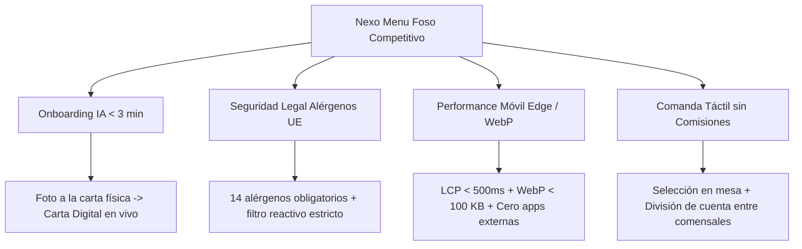

# BENCHMARKING DE MERCADO: CARTAS DIGITALES & ORDER-AT-TABLE (HOSTELERÍA)
**Análisis Comparativo Competitivo y Posicionamiento Estratégico de Nexo Menu**  
*Autor: Nexo-PO-Menu (Product Owner) | Versión: 1.0.0 | Fecha: Noviembre 2026*

---

## 1. Resumen Ejecutivo & Contexto del Sector

El sector de la hostelería en España y Europa ha transitado desde la digitalización de emergencia (PDFs estáticos en códigos QR de baja calidad durante 2020-2021) hacia soluciones interactivas orientadas a la experiencia del comensal, la eficiencia de sala y el aumento del ticket medio (upselling).

Sin embargo, la mayoría de soluciones comerciales del mercado sufren de al menos una de las siguientes tres fricciones críticas:
1. **Altos costes fijos o comisiones por transacción**: Cuotas mensuales recurrentes elevadas (49 € - 120 €/mes) o comisiones del 1.5% al 3.5% por pedido en mesa que merman el estrecho margen del hostelero independiente.
2. **Onboarding manual y tedioso**: El hostelero debe teclear uno a uno cada plato, precio y alérgeno en formularios engorrosos, tardando días en digitalizar su oferta.
3. **Pobre experiencia móvil y lentitud**: Cartas pesadas que tardan más de 3 segundos en cargar en redes móviles saturadas dentro del local, o que obligan a descargar apps nativas.

**Nexo Menu** se posiciona en el cuadrante de **máxima agilidad operativa (< 3 min onboarding con IA), 0 € coste fijo base y máximo rigor legal (Reglamento UE 1169/2011)**.

---

## 2. Matriz Comparativa de Competidores

Analizamos cuatro soluciones de referencia en España e internacionalmente:

| Parámetro de Evaluación | **Bakarta** | **MiCartaDigital** | **Yumminn** | **Sunday (Sunday App)** | **Nexo Menu (v1.0 + v1.1)** |
| :--- | :--- | :--- | :--- | :--- | :--- |
| **Enfoque Principal** | Carta digital interactiva básica | Menú QR para hostelería tradicional | Order & Pay en mesa (web móvil) | Pago en mesa rápido (Pay-at-table) | Carta interactiva ultrarrápida + IA + Pre-order |
| **Tiempo de Onboarding** | 2 - 4 horas (manual) | 1 - 2 horas (manual) | 3 - 7 días (integración TPV) | 1 - 3 semanas (integración POS) | **< 3 minutos (IA Multimodal OCR/Vision)** |
| **Modelo de Precios** | Freemium limitado / 12 € - 29 €/mes | 9 € - 19 €/mes | Cuota + 1.2% - 2.5% comisión | Comisión 1.5% - 2.9% + setup | **0 € coste fijo / SaaS escalable** |
| **Soporte de Fotografía** | Sí (baja compresión) | Sí (formatos tradicionales) | Sí (alta resolución) | Sí (orientado a catálogo) | **Sí: WebP en cliente (<100 KB, LCP < 500ms)** |
| **Filtro de 14 Alérgenos UE** | Iconos informativos básicos | Lista estática de alérgenos | Filtro por alérgenos en catálogo | Filtro dietético básico | **Filtro reactivo estricto (exclusión en tiempo real)** |
| **Soporte Multi-idioma** | Manual / Traductor Google | Manual ES/EN | Automático multidioma | Multidioma según navegador | **Instantáneo ES/EN sin recarga (decoupling)** |
| **Toma de Comanda en Mesa** | No | No (solo visualización) | Sí (pago directo con tarjeta) | Sí (pago directo / división) | **Comanda preliminar táctil + División de cuenta** |
| **Maridajes & Cross-Selling**| No | No | Recomendaciones basadas en reglas| Recomendaciones de postres/cafés | **Recomendaciones inteligentes por plato / Chef** |
| **Gestión de Menús por Turno**| Manual | Manual | Programable por horario | Conectado a TPV en tiempo real | **Turnos automáticos (Día/Noche/Finde)** |
| **Soporte Físico (Peana QR)**| Generador QR estándar | QR estándar descargable | Pegatinas de mesa personalizadas | Displays de acrílico con NFC/QR | **Peana A5 autoimprimible con QR Nivel H** |

---

## 3. Análisis en Profundidad de Competidores

### 3.1. Bakarta
- **Fortalezas**: Interfaz limpia, diseño responsive aceptable, popular en bares tradicionales españoles.
- **Debilidades**: El hostelero debe introducir los platos a mano. Las imágenes subidas suelen ser pesadas y ralentizan la carga inicial en 3G/4G. No cuenta con interacción de comanda ni cálculo de cuenta.
- **Lección para Nexo Menu**: Debemos superar su estética con fotografías profesionales optimizadas y eliminar por completo la fricción de entrada mediante nuestra IA multimodal.

### 3.2. MiCartaDigital
- **Fortalezas**: Económico, muy extendido en restaurantes familiares. Dispone de selector de idiomas.
- **Debilidades**: Interfaz anticuada tipo lista web de los 2010s. Los alérgenos se muestran como una fila abrumadora de iconos poco comprensibles para el comensal. Sin experiencia interactiva de mesa.
- **Lección para Nexo Menu**: La diferenciación radica en la UI premium (Tailwind CSS, modo oscuro/claro, tipografía cuidada) y el filtro reactivo de alérgenos que oculta lo que daña al comensal.

### 3.3. Yumminn
- **Fortalezas**: Excelente UX para pedir y pagar desde el móvil sin esperar al camarero. Aumenta la rotación de mesas hasta un 15-20%.
- **Debilidades**: Requiere integración técnica profunda con el TPV del restaurante (Hosteltáctil, Ágora, Revo, etc.). Esto frena las ventas en pequeños bares y genera comisiones de cobro que molestan a los hosteleros tradicionales.
- **Lección para Nexo Menu**: Implementar la **comanda preliminar táctil** (sin forzar pasarela bancaria ni TPV al inicio). El comensal prepara la comanda en su móvil, ve el importe exacto, la divide con sus amigos y se la muestra al camarero o la envía por WhatsApp al local. Cero fricción, 100% de utilidad.

### 3.4. Sunday (Sunday App)
- **Fortalezas**: Referente internacional en "Pay-at-table" (fundada por el grupo Big Mamma). Experiencia de división de cuenta impecable ("pagar mi parte", "dividir entre 4", propina integrada).
- **Debilidades**: Exclusivo para restaurantes de ticket medio-alto con TPVs compatibles. No resuelve la digitalización inicial de la carta ni la gestión de alérgenos de forma prominente.
- **Lección para Nexo Menu**: Incorporar la mecánica de **división de cuenta rápida (Bill Splitting)** en la comanda preliminar de Nexo Menu para resolver una de las mayores pesadillas del comensal en España: calcular cuánto paga cada uno en mesas de grupos.

---

## 4. Ventajas Competitivas Clave de Nexo Menu (El "Foso" Estratégico)

1. **Velocidad de Ingesta (TTV de 53 segundos)**: Ningún competidor permite subir una foto de una carta física y tenerla publicada y funcional en menos de un minuto.
2. **Protección Legal Total (Reglamento UE 1169/2011)**: Clasificación rigurosa de los 14 alérgenos con aviso legal y descarte reactivo en cliente.
3. **Experiencia Móvil Nativa en Web**: Carga instantánea desde Edge CDN, sin descargas de la App Store ni registros obligatorios para el comensal.
4. **Comanda Preliminar sin Intermediación Financiera**: Permite al comensal armar su pedido y calcular el gasto sin los costes ni ataduras de una pasarela de pago bancaria.
